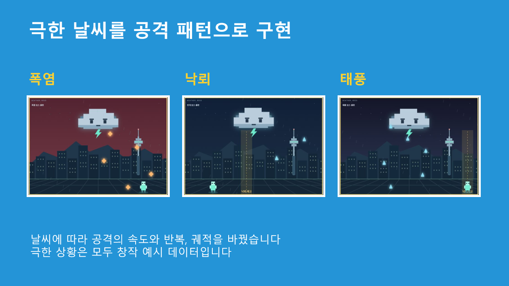

# 날씨 보스 (Weather Boss)

공공 기상 예보를 12초 회피 게임으로 바꾼 기후테크 포트폴리오입니다. 누구나 로그인 없이 플레이할 수 있습니다.

- **플레이**: https://weather-boss-play-261114.workspace-482617.chatgpt.site/
- **기술**: TypeScript, React, Vinext/Vite, Canvas, Cloudflare Workers 기반 Sites
- **AI 활용**: Codex의 코드 작성·검증 지원. 제작자 개인 역할의 상세 범위와 추가 AI 활용은 미정입니다.

## 구현된 기능

- 서울·대구·제주 한라산 지역 선택과 지역별 경기장 배경. 대구는 산 능선·도시·타워를 표현합니다.
- 실제 단기예보에서 연속 6시간을 확보한 날짜만 선택하고, 이를 12초 플레이로 압축합니다.
- 기온·풍속·강수형태에 따른 공격 변화. 같은 시각의 초단기예보에 낙뢰 값(LGT)이 있으면 결합하며 0보다 클 때 번개 공격을 활성화합니다. LGT는 확률(%)이 아닙니다.
- 실제 데이터와 구분된 폭염·낙뢰·태풍 **창작 예시 덤프**. 실제 재난 기록이나 위험 예측이 아닙니다.
- 좌우 방향키 또는 모바일 터치 버튼으로 회피, 하트 3개, 12초 생존 시 성공. Esc로 일시정지합니다.
- 진행 중 또는 일시정지 중 ‘경기장으로’를 누르면 게임이 초기화되고 지역·날짜·데이터를 다시 선택할 수 있습니다.

## 로컬 실행

Node.js 22.13 이상과 pnpm 11.25.0을 사용합니다.

```sh
cd weather_boss
pnpm install --frozen-lockfile
pnpm dev
```

터미널에 표시되는 로컬 주소로 접속하세요. API 키 없이도 데이터 메뉴에서 창작 예시를 선택해 플레이할 수 있습니다. 실제 예보는 키가 없으면 연결 안내를 표시합니다.

```sh
pnpm exec tsc --noEmit
node --experimental-strip-types --test tests/engine.test.mjs
pnpm build
pnpm start
```

`pnpm start`는 빌드한 결과를 로컬 Wrangler로 실행합니다. 테스트는 날씨 변환·회피 엔진 규칙을 확인합니다. 원본 앱의 마지막 검증은 타입 검사, 엔진 테스트 17개, 빌드 통과입니다. 이 저장본에서 의존성을 재설치한 검증은 별도로 수행하지 않았습니다.

## API 키와 배포

기상청 단기예보 조회서비스: https://www.data.go.kr/data/15084084/openapi.do

- `getVilageFcst`: TMP, WSD, PTY / `getUltraSrtFcst`: LGT
- 개인 기기에서만 `.dev.vars.example`을 `.dev.vars`로 복사하고 `KMA_SERVICE_KEY`에 본인의 인증키를 입력하세요.
- 공개 서버에는 서버 비밀 환경변수로 설정합니다. 브라우저용 변수나 코드에 인증키를 넣지 마세요.
- 실제 키, `.dev.vars`, `.env`, 설치 캐시, 빌드 산출물은 이 저장소에 포함하지 않았습니다. 현재 공개 사이트의 키는 Sites 서버에서 별도로 관리됩니다.
- GitHub 업로드는 소스 보관이며 자동 배포를 설정하지 않습니다. 기존 공개 사이트는 유지됩니다. 새 Sites 프로젝트로 배포할 때는 새 프로젝트 연결과 서버 비밀값 설정이 필요합니다.
- `.openai/hosting.json`의 기존 프로젝트 ID는 보관본에서 제거했습니다. 기존 사이트를 실수로 배포 대상으로 재사용하지 않도록 새 배포 대상을 연결하세요.

## 폴더와 문서

| 경로 | 내용 |
| --- | --- |
| `app/`, `components/WeatherGame.tsx` | 페이지, API, 게임 UI·Canvas |
| `lib/` | 예보 처리, 지역, 게임 규칙, 예시 데이터 |
| `public/data/weather-scenarios.json` | 공개 창작 예시 데이터 |
| `tests/` | 엔진 테스트 |
| `PRD.md`, `디자인.md` | 기획·디자인과 변경 이력 |
| `API_연결안내.md` | API 연결·키 관리 안내 |
| `presentation/` | 실제 화면을 넣은 5장·90초 PPT와 발표 대본 |
| `presentation/screenshots/` | 대구 및 폭염·낙뢰·태풍 화면 캡처 |

문서에 초기 기획과 후속 수정이 함께 남아 있습니다. 현재 동작은 위 ‘구현된 기능’과 각 문서의 최신 변경 항목을 기준으로 확인하세요. 대표 격자의 예보를 사용하며 실제 위치별 실측·등산 안전·재난 경보 서비스가 아닙니다. 캡처의 예보는 촬영 당시 화면입니다.

## 화면과 발표



[5장·90초 발표 PPT](presentation/날씨보스_90초_발표_완성.pptx) · [발표 대본](presentation/발표대본.md)

디자인 참고: [Pokémon Showdown](https://pokemonshowdown.com/), 발표 디자인 참고: [PPTBizcam](https://pptbizcam.co.kr/?p=11825). 참고 사이트의 템플릿 파일은 포함하지 않습니다. 제공된 라이브러리의 라이선스 파일은 원본 그대로 보관했습니다.
